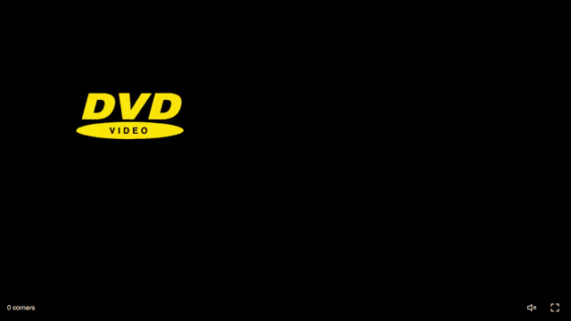

# Nothing But Corners

[](https://joekarlsson.github.io/nothing-but-corners/)
[](LICENSE)



Everybody has watched the DVD screensaver and waited for the logo to hit the
corner. Nothing But Corners aims every bounce, so the logo lands in a corner
every single time. Click and you get another logo, then another, until the
screen fills up with logos landing in corners, and with the sound on every
corner gets a cheer.

[Watch it](https://joekarlsson.github.io/nothing-but-corners/) ·
[Read the full statement](https://www.joekarlsson.com/work/nothing-but-corners/)

## Quick start

The page uses ES modules, so serve it rather than opening the file.

```sh
git clone https://github.com/JoeKarlsson/nothing-but-corners.git
cd nothing-but-corners
python3 -m http.server 4173   # http://localhost:4173
```

## Development

```sh
npm install
npm test            # unit tests, then browser tests
npm run test:unit   # path and timing logic (node:test)
npm run test:e2e    # Playwright in your installed Chrome, on a fake clock
```

The aiming is in `path.js`: mirror the screen across its walls and a bouncing
path becomes a straight line to a grid point `(m·W, n·H)` with
`gcd(m, n) = 1`. Paths whose bounces come within a quarter screen of a corner
are thrown out. The brake-in and ricochet-out timing lives in `motion.js`. The
browser tests open the page with `?test`, which exposes a read-only
`window.nothingButCorners` handle.

GitHub Pages serves `main`, so a push to `main` is a deploy.

## Credits

Sounds are short cuts from my sound effects library, including these from
Freesound: #563845 by disarmenemyships, #875405 by assetsmith, #834162 by
jw_audio, #402451 by plasterbrain, #131930 by mcpable, #512389 by kievinay.

## License

MIT. See [LICENSE](LICENSE).
